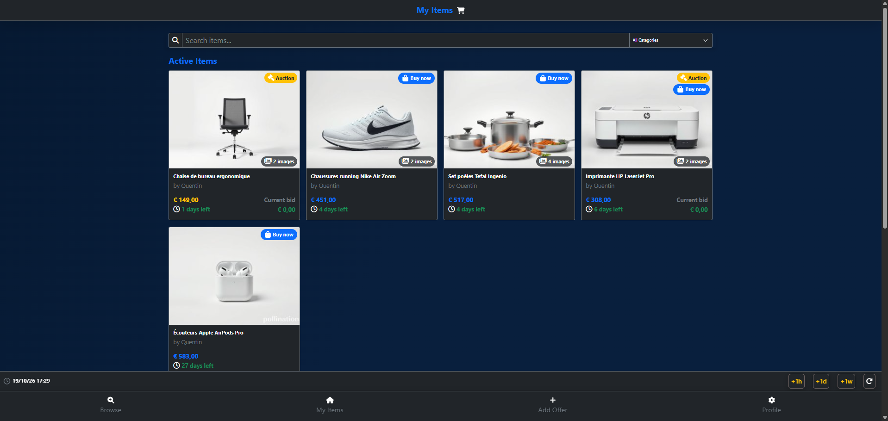

# EPayFC

EPayFC is an auction website developed as part of my Bachelor's degree in Application Development at EPFC (Brussels).

The application allows users to put items up for auction, browse available listings and participate in auctions.

## Technologies

- **Backend:** PHP 8
- **Architecture:** MVC (Model-View-Controller)
- **Frontend:** HTML, CSS, Bootstrap 5, JavaScript / jQuery
- **Database:** MySQL / PostgreSQL
- **Server:** Apache

## Features

- Creation and management of auction listings
- Browsing and purchasing items through auctions
- Database operations and data management
- MVC architecture to separate application logic from the interface

## Screenshots

### Login Screen

### Item List

### Item Details

## Author

**Jonathan Vanderbiest**

Bachelor's student in Application Development at EPFC, Brussels.
Currently looking for a development internship starting in February 2027. 
Professionnal email : jonathan.vanderbiest@outlook.com

